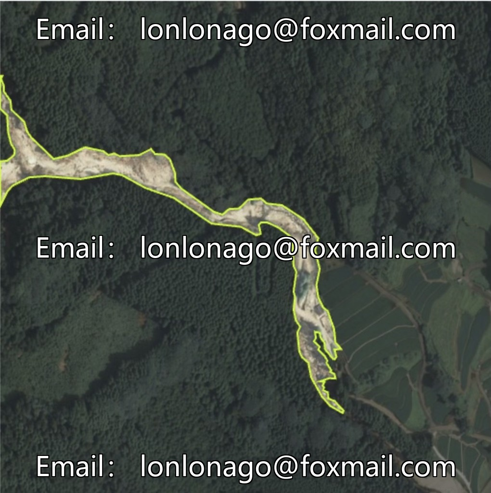
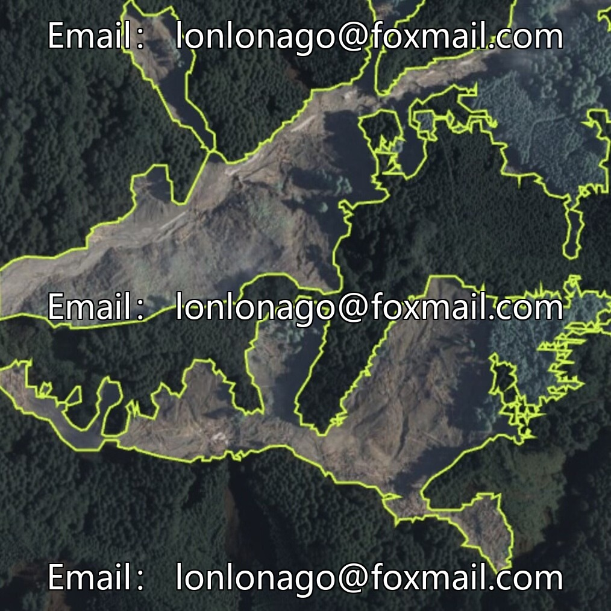
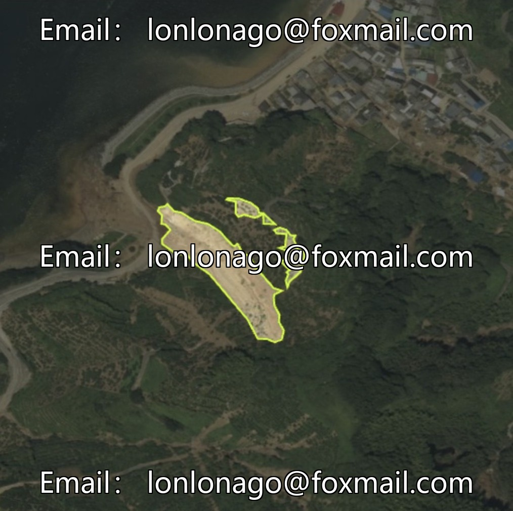
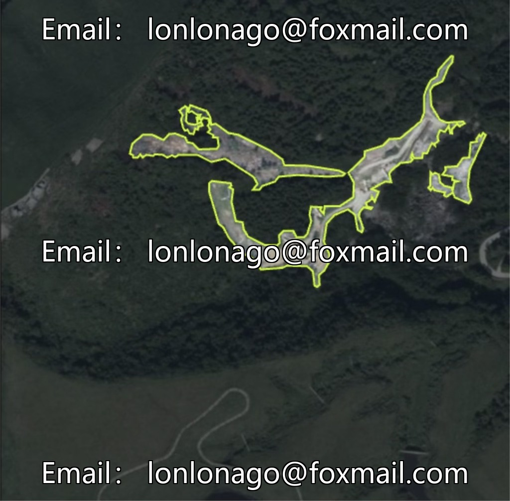
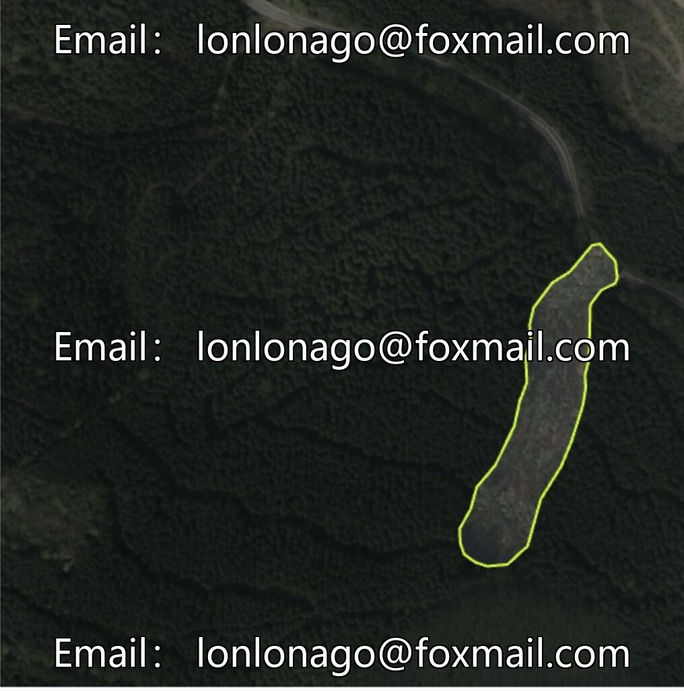

# Intelligent safety monitoring dataset for natural disaster image recognition, remote sensing debris flow image segmentation data

## Body

Intelligent Safety Monitoring - Natural Disaster Image Recognition Dataset, Satellite Images of Earthquake Landslides Segmentation Dataset, UAV Drone-Observed Landslide Image Recognition Dataset, UAV Landslide Monitoring Issue No. 10247

The dataset consists of 2435 images, with core categories being "debris-flow" and "landslide", suitable for instance segmentation tasks in the field of computer vision. It supports model training and testing. The data format is image files, with clear annotation formats, facilitating model development and testing.

The dataset focuses on geological disaster monitoring, including landslides and mudslides. It provides precise training samples to meet the needs of disaster identification and early warning technology research and development, enhancing the efficiency and accuracy of disaster identification, and serving in disaster prevention and mitigation efforts.

Virtual materials, once sold, are non-refundable.
Interested friends, click "I want" to proceed.

## Images

## Payment

Here is a pay link on Stripe ( https://buy.stripe.com/3cs8yP7sY87d0vu9AB ). Please contact me lonlonago@foxmail.com after funding $89, and I will send you a complete data files , thank you!

